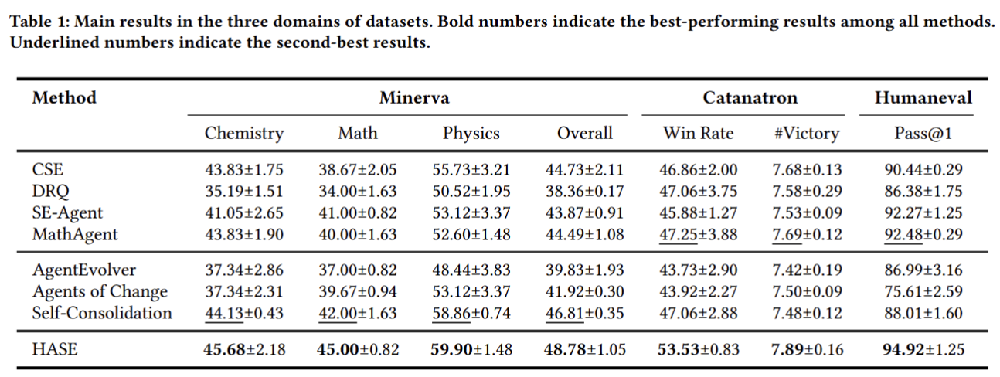
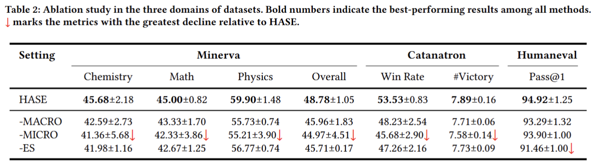

## Overview

Hierarchical adversarial self-evolution framework (HASE) is a hierarchical self-evolution framework for code generation, scientific reasoning, and strategic decision-making. It dynamically selects the macro role for reasoning direction, performs micro refinement through mirror adversarial feedback, and schedules the difficulty and duration of evolution according to the candidate's evolving reliability.

## Execution Commands

### Minerva
```
python paper/hase/science/run_minerva.py --max-rounds 15
```

### Catanatron
```
python paper/hase/strategy/run_catanatron.py --rounds 15
```

### HumanEval
```
python paper/hase/code/run_humaneval.py --rounds 15
```


## Results
### Overall Performance



### Ablation Study
